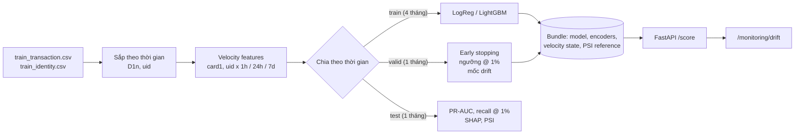

# Fraud detection end-to-end (IEEE-CIS)

[](https://github.com/ledung2411/Fraud-detection/actions/workflows/ci.yml)

Phát hiện gian lận giao dịch thẻ từ dữ liệu thô tới API chấm điểm, làm theo cách một
ngân hàng vận hành thật:

- **Chia train/test theo thời gian** (4 tháng train, 1 tháng valid, 1 tháng test), không random.
- **Feature velocity**: số giao dịch và tổng tiền của từng thẻ (`card1`) và từng khách
  (`uid = card1 + addr1 + D1n`) trong 1h / 24h / 7 ngày, chỉ dùng giao dịch *trước đó*.
- **LightGBM so với baseline Logistic Regression**, mỗi model chạy có và không có velocity (4 model).
- Đo bằng **PR-AUC** và **recall tại ngân sách review cố định 1%**, kèm khoảng tin cậy
  bootstrap theo ngày và ngưỡng được **chốt trên tháng valid** rồi mới áp sang tháng test.
- **SHAP**: mức độ quan trọng toàn cục cho báo cáo, và *reason codes* cho từng giao dịch bị gắn cờ.
- **FastAPI** chấm điểm real-time, tự tính velocity bằng state online, cộng thêm **drift check (PSI)**.
- **Không có training/serving skew**: phát lại cả tháng test qua API, điểm số khớp offline tới từng bit.

> **Về số liệu trong README.** Dữ liệu IEEE-CIS thuộc cuộc thi Kaggle nên không được phân
> phối lại, và môi trường build project này không truy cập được Kaggle. Các con số dưới đây
> chạy trên **dữ liệu synthetic cùng schema với IEEE-CIS** (`src/fraud_detection/synthetic.py`)
> để chứng minh pipeline chạy đúng end-to-end. Chạy `make train-ieee` (xem
> [data/README.md](data/README.md)) để có số thật; báo cáo đầy đủ tự sinh ra ở
> `reports/ieee/report.md`.

## Kết quả (tháng test, dữ liệu synthetic)

| Model | PR-AUC [95% CI] | Recall @ 1% | Precision @ 1% | Recall @ 2% | Recall @ 5% | Tiền gian lận bắt được @ 1% |
|---|---|---|---|---|---|---|
| Logistic Regression, không velocity | 0,581 [0,540; 0,622] | 23,2% | 80,4% | 43,7% | 68,8% | 33,3% |
| Logistic Regression + velocity | 0,623 [0,577; 0,669] | 22,9% | 79,6% | 45,5% | 74,5% | 30,5% |
| LightGBM, không velocity | 0,669 [0,625; 0,708] | 23,4% | 81,2% | 48,2% | 77,6% | 24,5% |
| **LightGBM + velocity** | 0,704 [0,663; 0,750] | 23,7% | 82,1% | 48,3% | 81,7% | 23,2% |

- Tháng test: 48.040 giao dịch, tỉ lệ gian lận 3,5%, nên hàng đợi 1% chứa tối đa 28,9% số ca gian lận.
- LightGBM hơn Logistic Regression (cùng feature): PR-AUC +0,081, khoảng tin cậy 95% của chênh lệch cặp đôi [0,064; 0,101].
- Velocity giúp LightGBM: PR-AUC +0,035 [0,009; 0,054], recall @ 5% 77,6% → 81,7%; với Logistic Regression PR-AUC 0,581 → 0,623.
- Ngưỡng chốt trên tháng valid gắn cờ 0,95% giao dịch của tháng test (mục tiêu 1%), bắt 22,6% ca gian lận với precision 82,1%.

Báo cáo đầy đủ (bảng, CI, drift theo tuần, SHAP): [reports/synthetic/report.md](reports/synthetic/report.md).

| | |
|---|---|
|  |  |
|  |  |

## Kiến trúc



## Chạy thử

```bash
make install        # pip install -e ".[dev]"
make train          # sinh dữ liệu synthetic + chạy toàn bộ pipeline (~2 phút)
make serve          # API ở http://localhost:8000, tài liệu ở /docs
make replay         # bắn tháng test qua API: kiểm tra skew, độ trễ, drift
make test           # 25 test, ~20 giây

make train-ieee     # dữ liệu Kaggle thật, xem data/README.md
```

Gọi API:

```bash
curl -s localhost:8000/score -H 'content-type: application/json' -d '{
  "TransactionID": 1, "TransactionDT": 15811047, "TransactionAmt": 49.0,
  "ProductCD": "W", "card1": 2803, "addr1": 299, "D1": 0, "P_emaildomain": "gmail.com"
}'
```

```json
{
  "TransactionID": 1,
  "fraud_score": 0.0055,
  "decision": "approve",
  "threshold": 0.888,
  "reasons": [],
  "model_version": "20261026102051"
}
```

Một giao dịch thật của tháng test bị đưa vào hàng đợi review (365,43 USD lúc 3 giờ sáng, 11
phút sau giao dịch trước của cùng khách), kèm reason codes từ SHAP:

```json
{
  "TransactionID": 3203479,
  "fraud_score": 0.919,
  "decision": "review",
  "reasons": [
    {"feature": "hour", "description": "hour of day", "value": 3.0, "contribution": 1.34},
    {"feature": "uid_secs_since_prev",
     "description": "seconds since the previous transaction of this client (card1+addr1+D1n)",
     "value": 683.0, "contribution": 1.17},
    {"feature": "TransactionAmt", "description": "transaction amount", "value": 365.43, "contribution": 1.10}
  ]
}
```

Chỉ `TransactionID`, `TransactionDT`, `TransactionAmt` là bắt buộc; mọi cột IEEE-CIS khác
(`C1..C14`, `D1..D15`, `M1..M9`, `V1..V339`, `id_01..id_38`, `DeviceInfo`...) gửi kèm thì
được dùng, thiếu thì coi là missing. Endpoint:

| Endpoint | Việc |
|---|---|
| `POST /score` | chấm 1 giao dịch, cập nhật velocity state, trả `decision` và reason codes nếu bị gắn cờ |
| `POST /score/batch` | tối đa 1.000 giao dịch, tự sắp theo thời gian |
| `GET /monitoring/drift` | PSI của 5.000 giao dịch gần nhất so với tháng valid, cộng tỉ lệ gắn cờ so với ngân sách |
| `GET /model` | version, ngưỡng, kỳ train/valid/test, metric trên test |
| `GET /health` | health check |

Tham số `update_state=false` để chấm thử mà không tính vào lịch sử; `explain=all|review|none`
chọn giao dịch nào có SHAP reason codes (mặc định chỉ giao dịch bị đưa vào hàng đợi review,
vì TreeSHAP tốn vài ms mỗi dòng còn chấm điểm chưa tới 1 ms).

## Các quyết định thiết kế

### 1. Chia theo thời gian

`split.py` cắt theo **ngày**: mọi ngày của valid đứng sau mọi ngày của train, test là tháng
cuối. Chia random sẽ đưa các giao dịch của cùng một đợt tấn công (cùng thẻ, cùng giờ) vào cả
hai phía, tức là model "nhìn thấy đáp án", và che mất concept drift mà model sẽ gặp khi chạy
thật. Tháng valid dùng cho early stopping, chọn ngưỡng và làm mốc drift; **tháng test chỉ
dùng để báo cáo**. `gap_days` trong config cho phép bỏ một khoảng giữa train và valid để mô
phỏng nhãn về trễ (chargeback thường mất vài tuần).

### 2. Feature velocity, không leakage

`velocity.py` tính cho mỗi entity (`card1` để bắt tấn công dò thẻ theo BIN, `uid` để bắt
một tài khoản bị chiếm quyền) và mỗi cửa sổ 1h / 24h / 7d:

| Feature | Ý nghĩa |
|---|---|
| `{e}_cnt_{w}`, `{e}_amt_sum_{w}` | số giao dịch / tổng tiền *trước đó* trong cửa sổ |
| `{e}_amt_ratio_{w}` | số tiền hiện tại / trung bình trong cửa sổ |
| `{e}_secs_since_prev` | số giây từ giao dịch trước |
| `{e}_n_prior`, `{e}_amt_mean_hist`, `{e}_amt_z_hist` | lịch sử: số lần, trung bình, độ lệch của số tiền hiện tại (đơn vị độ lệch chuẩn) |

`uid = card1 + addr1 + D1n` với `D1n = ngày giao dịch - D1` (D1 là số ngày kể từ khi khách
bắt đầu quan hệ, nên `D1n` cố định cho một khách) là mẹo nhận diện khách của đội đứng đầu
cuộc thi. Thiếu một thành phần thì entity là missing, không gộp tất cả vào một nhóm "nan".

Chống leakage: chỉ giao dịch đứng **trước** trong luồng (thứ tự `(TransactionDT,
TransactionID)`) được đếm, giao dịch hiện tại không thấy chính nó, và **không feature nào
dùng nhãn**. `tests/test_velocity.py::test_no_lookahead` sửa toàn bộ tương lai rồi kiểm tra
feature của quá khứ không đổi. Các encoder (category, frequency) chỉ fit trên kỳ train.

Có hai cài đặt cùng một định nghĩa: bản vector hoá (numpy, toàn bộ lịch sử trong ~2 giây cho
600k dòng) cho training, và `OnlineVelocityStore` (state theo entity, cập nhật từng giao dịch)
cho API. Hai bản được test khớp nhau, và `make replay` kiểm tra lại qua HTTP.

### 3. Baseline công bằng

Logistic Regression không phải "bù nhìn": log có dấu cho đuôi dày (số tiền, số đếm), median
imputation kèm cờ missing, chuẩn hoá, one-hot có giới hạn cho biến phân loại. Cả hai model
được chạy trên cùng tập feature, có và không có velocity, để tách riêng phần lợi do **model**
và phần lợi do **feature engineering**.

### 4. Đo đúng thứ ngân hàng cần

Với ~3,5% fraud, accuracy vô nghĩa và ROC-AUC model nào cũng cao. Câu hỏi thật là: *đội
review chỉ duyệt tay được 1% giao dịch, hàng đợi đó bắt được bao nhiêu gian lận?*

- **PR-AUC** (average precision) tóm tắt đánh đổi precision/recall trên mọi ngân sách.
- **Recall / precision / số tiền gian lận bắt được @ 1%**, cùng đường cong theo ngân sách
  0-10%. Trần lý thuyết là `budget / fraud_rate` (1% / 3,5% ≈ 29%), nên recall @ 1% luôn đọc
  cùng precision @ 1%.
- **Ngưỡng vận hành** được chốt trên tháng valid (điểm cắt cho đúng 1% giao dịch) rồi áp
  nguyên sang tháng test, đúng như khi triển khai. Tỉ lệ gắn cờ thực tế lệch khỏi 1% cho biết
  hàng đợi sẽ thừa hay thiếu người.
- **Khoảng tin cậy 95%** bằng bootstrap **theo ngày** (gian lận đến theo đợt nên các dòng không
  độc lập), cặp đôi giữa các model để so sánh có ý nghĩa thống kê.

### 5. SHAP

LightGBM có sẵn TreeSHAP chính xác (`pred_contrib=True`, cùng thuật toán với
`shap.TreeExplainer`), nên API không cần thư viện `shap`. Báo cáo có beeswarm, bar và
waterfall cho giao dịch gian lận có điểm cao nhất; API trả **reason codes** (top feature đẩy
điểm lên, giá trị thật và mô tả dễ đọc) để analyst biết vì sao giao dịch bị giữ lại.

### 6. API và drift

Model, encoder, velocity state (tính tới đầu tháng test) và phân phối tham chiếu cho PSI được
lưu chung một bundle (`artifacts/`). API tự tính mọi feature, chấm điểm trong < 1 ms (không
tính reason codes), và giữ 5.000 giao dịch gần nhất để tính **PSI** từng feature và PSI của
điểm số so với tháng valid (< 0,1 ổn định, 0,1-0,25 cần xem, > 0,25 dịch chuyển lớn). PSI
không cần nhãn, quan trọng vì nhãn gian lận về trễ hàng tuần; cùng với tỉ lệ gắn cờ ở ngưỡng
đã chốt, đây là cảnh báo sớm nhất cho việc cần điều tra hoặc retrain.

Drift check đã bắt được lỗi của chính project: phiên bản đầu có feature
`days_since_first` (số ngày từ lần đầu thấy thẻ). Vì "lần đầu thấy" là ngày bắt đầu dữ liệu,
feature đó thực chất là đồng hồ thời gian, PSI giữa valid và test lên tới 5,2. Feature này
đã bị bỏ; số giao dịch trước đó và D1 mang thông tin hữu ích mà không trôi theo lịch.

## Câu hỏi phỏng vấn hay gặp

<details>
<summary><b>Tại sao không chia random?</b></summary>

Giao dịch gian lận đến theo đợt: một thẻ bị lộ tạo ra nhiều giao dịch trong vài giờ. Chia
random đặt các anh em của cùng một đợt ở cả train và test, metric đẹp nhưng không tái hiện
được khi chạy thật. Chia theo thời gian còn đo được độ suy giảm do drift.
</details>

<details>
<summary><b>Velocity feature tính trên toàn bộ dữ liệu, có phải leakage không?</b></summary>

Không, vì mỗi giao dịch chỉ nhìn các giao dịch **trước nó** và không dùng nhãn. Khi chạy
thật, lịch sử giao dịch luôn có sẵn ngay lập tức; chỉ có nhãn là về trễ. Test
`test_no_lookahead` chứng minh: thay đổi tương lai không làm đổi feature của quá khứ.
</details>

<details>
<summary><b>Làm sao chắc feature lúc serving giống lúc training?</b></summary>

Hai đường tính feature (batch và online) có test so khớp, và `replay.py` bắn toàn bộ tháng
test qua API rồi so điểm với điểm offline: chênh lệch lớn nhất là 0,0 trên 48.040 giao dịch
(độ trễ mỗi request p50 2,7 ms, p95 3,9 ms với client HTTP trong cùng process).
</details>

<details>
<summary><b>Sao không dùng SMOTE hay class weight?</b></summary>

Metric ở đây là xếp hạng (ai vào top 1%), không phụ thuộc vào việc cân bằng lớp. Oversampling
làm sai lệch xác suất và dễ overfit các điểm tổng hợp. Nếu cần xác suất chuẩn (ví dụ để tính
tổn thất kỳ vọng) thì calibrate trên tháng valid.
</details>

<details>
<summary><b>Ngưỡng chọn thế nào, và nếu tỉ lệ gắn cờ tăng gấp đôi thì sao?</b></summary>

Ngưỡng là điểm cắt cho đúng 1% giao dịch của tháng valid. API theo dõi tỉ lệ gắn cờ thực tế;
lệch quá 50% so với ngân sách thì trạng thái drift chuyển sang cảnh báo. Khi đó xem PSI từng
feature để tìm nguyên nhân (feature mới, đổi hành vi khách, tấn công mới), rồi quyết định
chỉnh ngưỡng, retrain hay báo cho đội vận hành.
</details>

<details>
<summary><b>Recall @ 1% của các model gần bằng nhau, vậy LightGBM có đáng không?</b></summary>

Ở ngân sách rất chặt, model nào cũng lấp hàng đợi bằng các ca rõ ràng nhất và đều chạm trần
precision của dữ liệu. Khác biệt mở ra ở 2-5% và ở PR-AUC, xem bảng và đường cong. Ngược lại
Logistic Regression bắt được nhiều **tiền** gian lận hơn ở 1% vì nó xếp số tiền lớn lên đầu:
nếu mục tiêu là giảm tổn thất thì nên train có trọng số theo số tiền.
</details>

## Cấu trúc

```
configs/            ieee.yaml (dữ liệu thật), synthetic.yaml
src/fraud_detection/
  data.py           đọc IEEE-CIS, gộp identity, sắp theo thời gian, D1n
  synthetic.py      dữ liệu giả lập cùng schema IEEE-CIS (có nhãn nhiễu và drift cài sẵn)
  velocity.py       velocity offline (vector hoá) + OnlineVelocityStore
  features.py       feature tĩnh, encoder fit trên train, đường nhanh cho từng dòng
  split.py          chia theo thời gian
  models.py         Logistic Regression baseline, LightGBM
  metrics.py        PR-AUC, recall/precision/số tiền @ ngân sách, bootstrap theo ngày
  explain.py        SHAP, reason codes
  drift.py          PSI cho feature và điểm số
  train.py          pipeline end-to-end, xuất report + bundle
  replay.py         phát lại tháng test qua API
  api/              FastAPI app, schema, service
tests/              velocity, feature, metric, split, drift, pipeline + API
reports/synthetic/  báo cáo mẫu sinh ra từ `make train`
```

## Hạn chế và hướng mở rộng

- Số liệu trong README là synthetic; cần chạy lại trên IEEE-CIS để có kết quả thật.
- `uid` chỉ là ước lượng danh tính khách; ngân hàng thật có customer ID.
- Velocity state nằm trong bộ nhớ của một process: chạy nhiều worker uvicorn thì mỗi worker
  có state riêng. Bản production đưa state ra Redis hoặc feature store, có TTL.
- Giả định giao dịch đến đúng thứ tự thời gian; sự kiện đến trễ cần xử lý riêng.
- Chưa có calibration, chưa train theo trọng số số tiền, chưa có quy trình champion/challenger
  và retrain định kỳ.
- Dockerfile chưa được build thử trong môi trường phát triển (không có Docker daemon).
