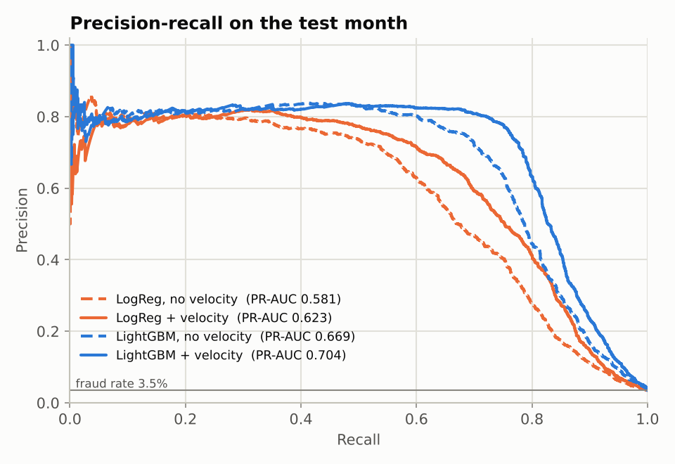
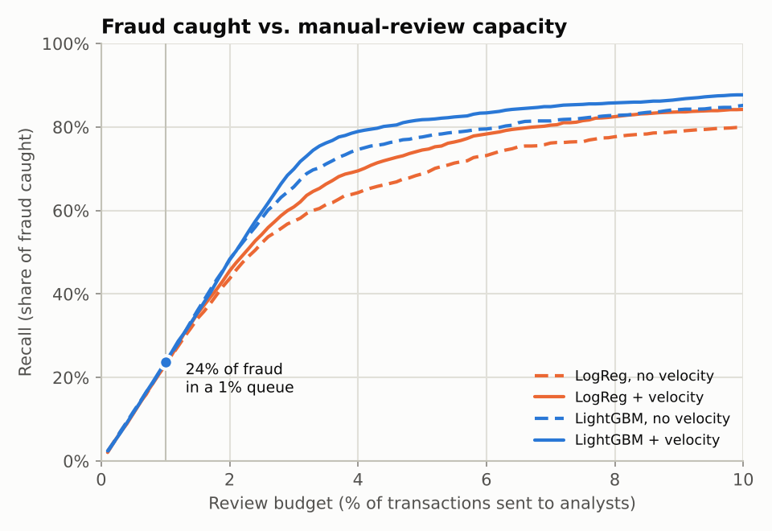
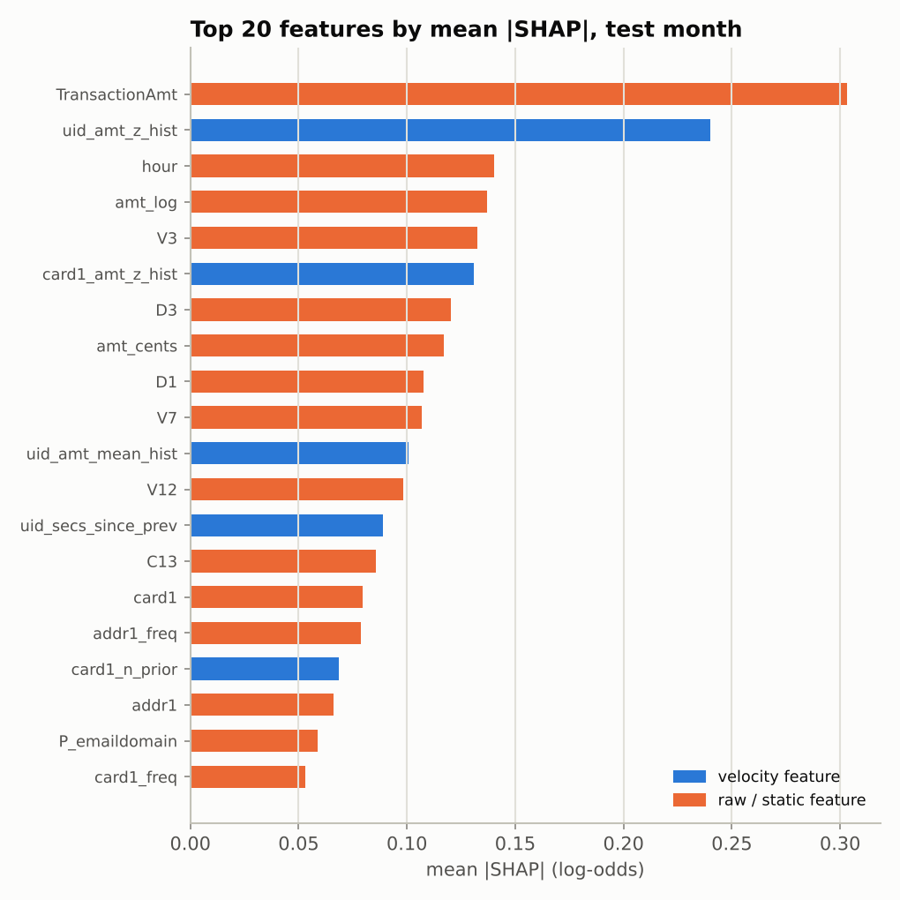
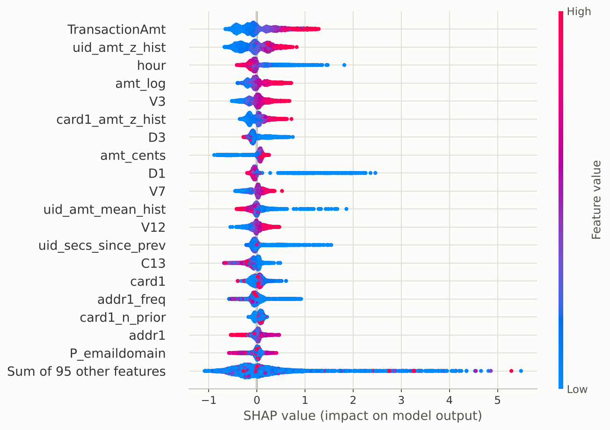
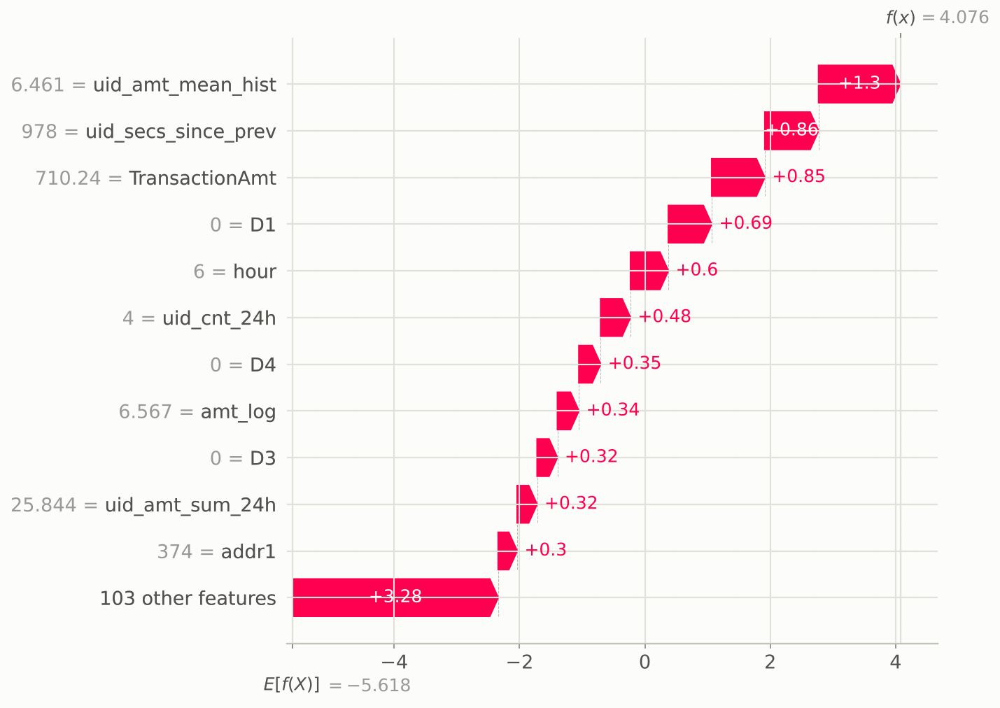
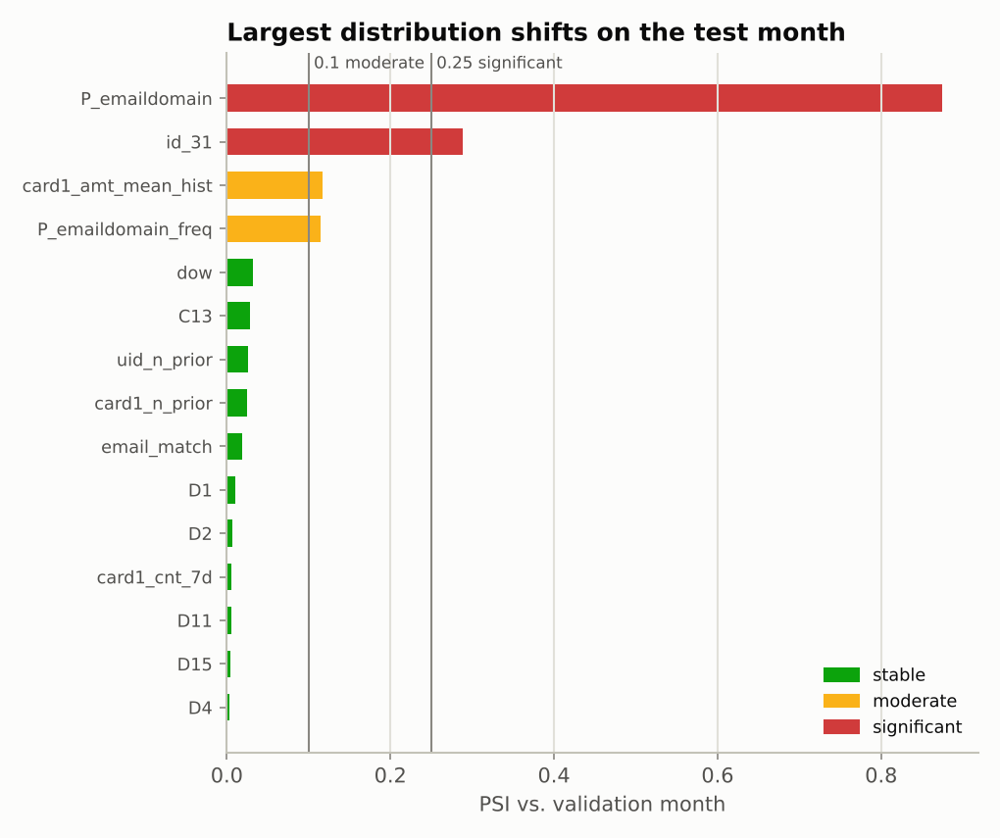
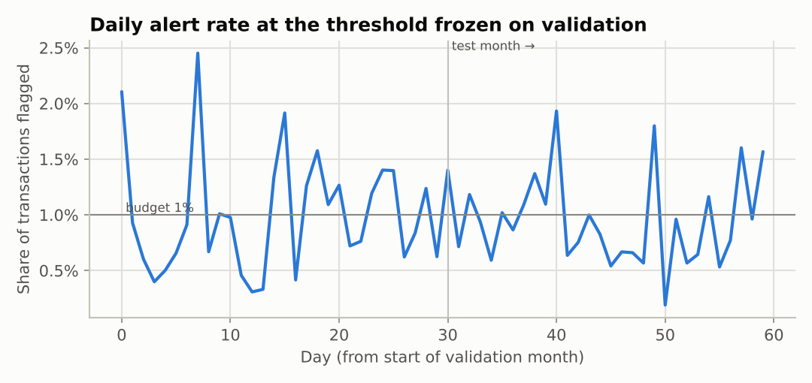

# Fraud detection report - `synthetic` data

> **Synthetic data.** These numbers come from the IEEE-CIS-shaped generator in
> `src/fraud_detection/synthetic.py`; they show that the pipeline works end to end,
> not how the model performs on real transactions. Run `make train-ieee` for that.

264,479 transactions, fraud rate 3.08%. Review budget: **1.0% of transactions** can be checked by analysts.

## Out-of-time split

| Period | Days | Rows | Fraud rate | Used for |
|---|---|---|---|---|
| train | 1-122 | 170,168 | - | fitting models and encoders |
| valid | 123-152 | 46,271 | 3.72% | early stopping, choosing the alert threshold, drift reference |
| test | 153-182 | 48,040 | 3.47% | all reported numbers |

## Results on the test month

| Model | PR-AUC [95% CI] | ROC-AUC | Recall @ 1% [95% CI] | Precision @ 1% | Fraud $ caught @ 1% |
|---|---|---|---|---|---|
| Logistic Regression - no velocity | 0.581 [0.540, 0.622] | 0.922 | 23.2% [20.2%, 25.8%] | 80.4% | 33.3% |
| Logistic Regression + velocity | 0.623 [0.577, 0.669] | 0.937 | 22.9% [20.4%, 25.9%] | 79.6% | 30.5% |
| LightGBM - no velocity | 0.669 [0.625, 0.708] | 0.948 | 23.4% [20.6%, 26.5%] | 81.2% | 24.5% |
| **LightGBM + velocity** | 0.704 [0.663, 0.750] | 0.959 | 23.7% [20.5%, 26.7%] | 82.1% | 23.2% |

Ceiling: with 3.47% fraud in the test month, a 1% queue can hold at most 28.9% of all fraud (if every reviewed transaction were fraud), so recall @ 1% must be read together with precision @ 1%.

Confidence intervals: bootstrap that resamples whole **days** of the test month (fraud arrives in bursts, so rows are not independent). Paired differences (same resamples for both models):

- lgbm_velocity - logreg_velocity: PR-AUC [0.064, 0.101], recall @ 1% [-0.3%, 2.0%]
- lgbm_velocity - lgbm_base: PR-AUC [0.009, 0.054], recall @ 1% [-1.0%, 1.1%]

### Recall at other review budgets

| Model | 0.5% | 1% | 2% | 5% |
|---|---|---|---|---|
| Logistic Regression - no velocity | 11.4% | 23.2% | 43.7% | 68.8% |
| Logistic Regression + velocity | 11.4% | 22.9% | 45.5% | 74.5% |
| LightGBM - no velocity | 11.8% | 23.4% | 48.2% | 77.6% |
| **LightGBM + velocity** | 11.5% | 23.7% | 48.3% | 81.7% |

### Operating the threshold

A real deployment cannot rank the test month in hindsight: the cut-off is fixed on the validation month (score >= 0.8880 flags 1% there) and then applied to new traffic. On the test month that frozen threshold flags **0.95%** of transactions, catching 22.6% of fraud at 82.1% precision. A flag rate drifting away from the budget is the first, label-free sign that the queue will be over- or under-staffed.

## What drives the score (SHAP)

| # | Feature | Meaning | mean abs SHAP |
|---|---|---|---|
| 1 | `TransactionAmt` | transaction amount | 0.303 |
| 2 | `uid_amt_z_hist` (velocity) | how unusual this amount is for this client (card1+addr1+D1n) (std. deviations) | 0.240 |
| 3 | `hour` | hour of day | 0.140 |
| 4 | `amt_log` | transaction amount (log) | 0.137 |
| 5 | `V3` | V3 | 0.132 |
| 6 | `card1_amt_z_hist` (velocity) | how unusual this amount is for this card BIN (card1) (std. deviations) | 0.131 |
| 7 | `D3` | D3 | 0.120 |
| 8 | `amt_cents` | cents part of the amount (non-round = currency conversion) | 0.117 |
| 9 | `D1` | days since the client relationship started | 0.108 |
| 10 | `V7` | V7 | 0.107 |
| 11 | `uid_amt_mean_hist` (velocity) | average historical amount of this client (card1+addr1+D1n) | 0.101 |
| 12 | `V12` | V12 | 0.098 |
| 13 | `uid_secs_since_prev` (velocity) | seconds since the previous transaction of this client (card1+addr1+D1n) | 0.089 |
| 14 | `C13` | C13 | 0.086 |
| 15 | `card1` | card1 | 0.080 |

5 of the top 20 features are velocity features.

Explanation of the highest-scored fraud in the sample:

## Drift: test month vs. validation month

| Feature | PSI | Status | Missing (ref -> test) |
|---|---|---|---|
| `P_emaildomain` | 0.875 | significant | 15.1% -> 13.2% |
| `id_31` | 0.288 | significant | 72.2% -> 72.0% |
| `card1_amt_mean_hist` | 0.117 | moderate | 0.0% -> 0.0% |
| `P_emaildomain_freq` | 0.115 | moderate | 15.1% -> 13.2% |
| `dow` | 0.032 | stable | 0.0% -> 0.0% |
| `C13` | 0.028 | stable | 0.0% -> 0.0% |
| `uid_n_prior` | 0.026 | stable | 9.4% -> 9.7% |
| `card1_n_prior` | 0.024 | stable | 0.0% -> 0.0% |
| `email_match` | 0.019 | stable | 61.5% -> 61.4% |
| `D1` | 0.010 | stable | 0.0% -> 0.0% |

Week by week (PSI of the model score, and the share flagged at the frozen threshold):

| Week | Rows | Score PSI | Alert rate | Features with PSI > 0.25 |
|---|---|---|---|---|
| 1 | 11,227 | 0.001 | 0.95% | 0 |
| 2 | 11,102 | 0.001 | 1.13% | 1 |
| 3 | 11,295 | 0.003 | 0.75% | 2 |
| 4 | 11,198 | 0.001 | 0.89% | 2 |
| 5 | 3,218 | 0.003 | 1.27% | 3 |

_Generated by `python -m fraud_detection.train` in 97s._
